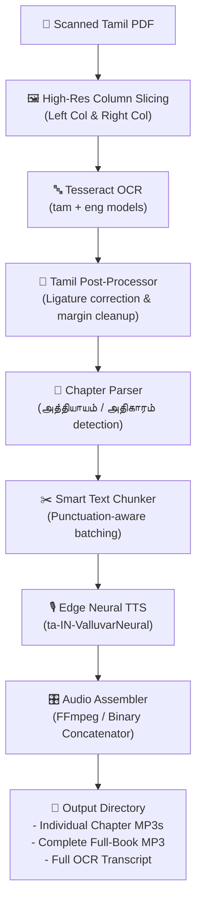

# 🎧 Tamil Text-to-Audio (Audiobook Engine)

[](https://www.python.org/)
[](https://github.com/tesseract-ocr/tesseract)
[](https://github.com/rany2/edge-tts)
[](#)
[](LICENSE)

An automated pipeline designed to transform scanned, multi-column Tamil books and PDF documents into natural, chapter-segmented neural audiobooks.

---

## 🌟 Overview

Converting scanned historical or printed Tamil literature into audiobooks poses unique challenges:
- **Two-Column Formats**: Standard OCR engines scan horizontally across columns, interweaving verses and scrambling reading order.
- **Complex Ligatures & Fonts**: Tamil vowel modifiers and conjunct characters frequently degrade in standard OCR outputs.
- **Robotic Synthesizers**: Generic TTS models often struggle with Tamil cadence, sentence boundaries, and punctuation pacing.

**Text-to-Audio** solves these hurdles with a tailored, column-segmented preprocessing pipeline, intelligent Tamil ligature post-correction, and Microsoft Edge's state-of-the-art neural speech synthesis.

---

## 🚀 Key Features

- **📑 Column-Aware Reading Order**: Slices pages into isolated Left and Right columns before OCR, guaranteeing strict chronological reading order.
- **✨ Intelligent Margin & Cover Cropping**: Excludes top running headers, page numbers, and title cover art automatically.
- **🔍 Tamil Ligature Correction**: Cleans zero-width formatting characters (`\u200c`, `\u200b`) and corrects common Tamil OCR conjunct misrecognitions (e.g., `நீதிமான்`, `ஆசீர்வதித்தார்`).
- **📖 Chapter Segmentation**: Detects chapter boundaries across both `அத்தியாயம்` and `அதிகாரம்` headings to export separate, well-titled MP3 tracks.
- **🗣️ Natural Neural Narration**: Uses Microsoft Edge's deep-learning voice models (`ta-IN-ValluvarNeural`) with fine-tuned pitch and speech rate.
- **🧩 Smart Punctuation Chunking**: Splits lengthy chapters along natural sentence and paragraph pauses without clipping words.
- **🎵 Flexible Audio Merging**: Assembles tracks seamlessly using FFmpeg when present, with a native binary MP3 merger fallback.

---

## 🔄 Processing Pipeline



---

## 🛠️ Prerequisites

1. **Python 3.10+**
2. **Tesseract OCR with Tamil Data**:
   - **Windows**: Install [UB-Mannheim Tesseract](https://github.com/UB-Mannheim/tesseract/wiki) and check `Tamil` during installation (or place `tam.traineddata` in your `tessdata` directory).
   - **Ubuntu/Debian**:
     ```bash
     sudo apt update && sudo apt install tesseract-ocr tesseract-ocr-tam
     ```
   - **macOS**:
     ```bash
     brew install tesseract tesseract-lang
     ```
3. **FFmpeg** *(Optional)*: Recommended for audio encoding. If not installed, the engine automatically falls back to clean binary stream concatenation.

---

## 📦 Installation

1. **Clone the repository:**
   ```bash
   git clone https://github.com/Jeffrin-Singh/text-to-audio.git
   cd text-to-audio
   ```

2. **Create and activate a virtual environment:**
   ```bash
   # Windows (PowerShell)
   python -m venv venv
   .\venv\Scripts\Activate.ps1

   # Linux / macOS
   python3 -m venv venv
   source venv/bin/activate
   ```

3. **Install dependencies:**
   ```bash
   pip install -r requirements.txt
   ```

---

## 💻 Usage

Run the converter by pointing to any Tamil PDF:

```bash
python create_audiobook.py "Tamil - Book of Enoch by R.H. Charles.pdf"
```

Or pass any custom PDF:
```bash
python create_audiobook.py "path/to/your_document.pdf"
```

### Generated Output Structure

The output directory `Book_of_Enoch_Tamil_Audiobook/` contains:

```text
Book_of_Enoch_Tamil_Audiobook/
├── Book_of_Enoch_Tamil_OCR.txt       # Clean, human-verified Tamil text transcript
├── 01_அதிகாரம்_1.mp3                 # Individual section/chapter audio
├── 02_அதிகாரம்_2.mp3
├── ...
├── Book_of_Enoch_Tamil_Complete.mp3  # Full unabridged master audiobook
└── parts/                            # Temporary raw synthesis chunks
```

---

## ⚙️ Configuration & Customization

You can customize voice settings directly at the top of `create_audiobook.py`:

```python
VOICE = 'ta-IN-ValluvarNeural'   # Tamil male voice
# Alternative: 'ta-IN-PallaviNeural' (Tamil female voice)
# Alternative: 'ta-LK-KumarNeural'   (Sri Lankan Tamil male)
RATE = '-8%'                     # Slight slowdown for natural cadence
PITCH = '-4Hz'                   # Subtle lower pitch for resonant reading
MAX_CHARS = 2600                 # Maximum characters per audio chunk
```

To list all available neural voices for Tamil or other languages:
```bash
edge-tts --list-voices | grep "ta-"
```

---

## 📂 Project Structure

```text
text-to-audio/
├── create_audiobook.py           # Core conversion & synthesis pipeline
├── requirements.txt              # Python package dependencies
├── .gitignore                    # Excludes build caches, venv, and large audio
└── README.md                     # Documentation
```

---

## 🤝 Contributing

Contributions are welcome! If you would like to add support for additional Indic languages, improve chapter regex heuristics, or implement GUI frontends:

1. Fork the Project
2. Create your Feature Branch (`git checkout -b feature/AmazingFeature`)
3. Commit your Changes (`git commit -m 'Add AmazingFeature'`)
4. Push to the Branch (`git push origin feature/AmazingFeature`)
5. Open a Pull Request

---

## 📜 License

Distributed under the MIT License. See `LICENSE` for more information.
